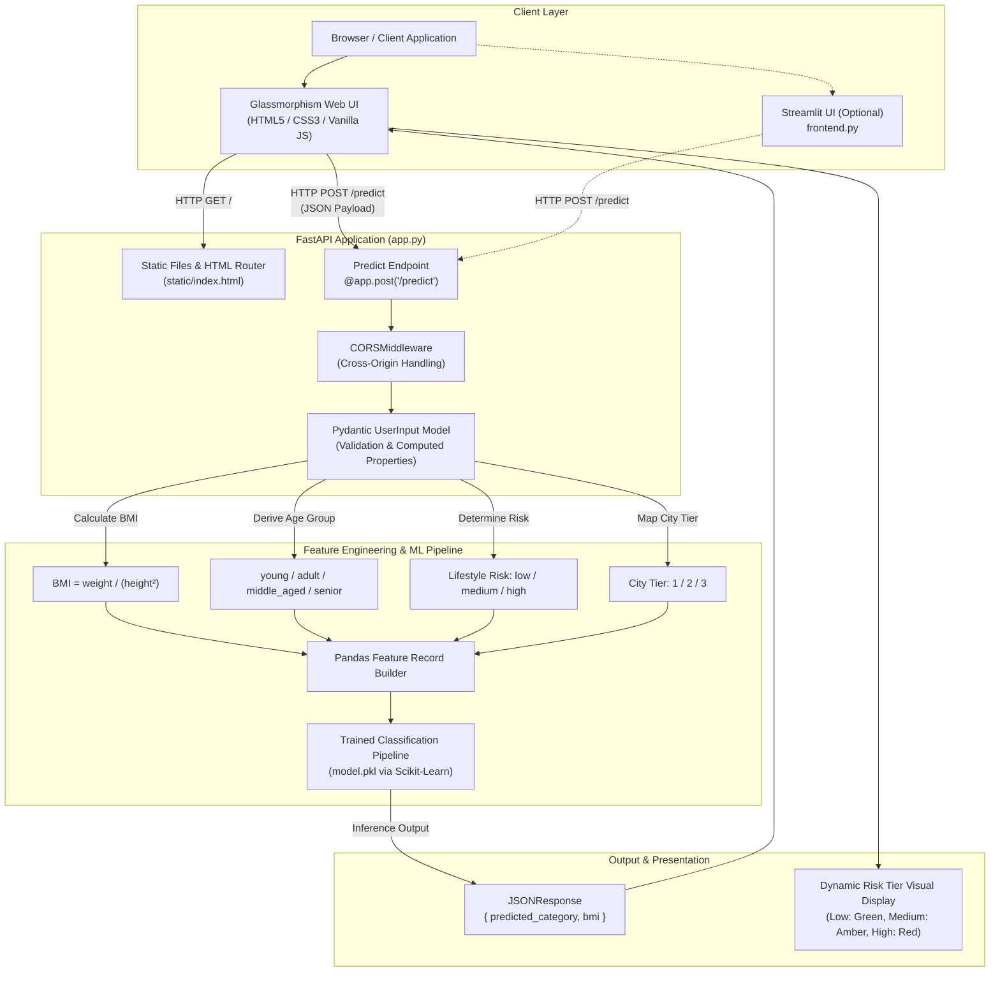
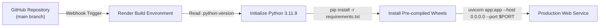

# AuraHealth - Insurance Premium Category Predictor

[](https://www.python.org/)
[](https://fastapi.tiangolo.com/)
[](https://scikit-learn.org/)
[](https://docs.pydantic.dev/)
[](https://render.com/)

An enterprise Machine Learning web application designed to evaluate and predict health insurance premium risk categories (**Low**, **Medium**, **High**) based on client biometrics, lifestyle indicators, geographic tiers, and income metrics.

The system utilizes a high-throughput **FastAPI** backend, a **Scikit-Learn** inference pipeline, and a modern **Glassmorphism Web Interface** with real-time biometric calculations.

---

## System Architecture



---

## Key Features

- **Minimalist Glassmorphism Interface:** Structured using modern CSS backdrop filters, translucent surface panels, responsive layouts, and ambient gradient depth.
- **Interactive 3D Perspective Card:** Visual asset featuring mouse-tracking perspective transforms.
- **Client-Side Biometric Computation:** Dynamically computes and displays Body Mass Index (BMI), clinical weight status (Underweight, Normal, Overweight, Obese), and lifestyle risk classification in real time during input adjustments.
- **Synchronized Controls:** Coordinated numerical badges and range sliders across age, weight, height, and annual income fields.
- **Data Validation & Type Safety:** Enforced via Pydantic v2 schemas with value boundaries (`gt`, `lt`), computed properties, and enumerated occupation classes.
- **Geographic Tier Normalization:** Automatically maps Indian municipalities into standardized risk tiers (Tier 1 Metros, Tier 2 Urban Centers, Tier 3 Regional).
- **Unified Service Architecture:** FastAPI concurrently manages static asset delivery and REST API routing within a single asynchronous process.

---

## Repository Structure

```text
Insurance-Premium-Predictor/
├── .gitignore               # Version control exclusions
├── .python-version          # Pinned to Python 3.11.9 for runtime consistency
├── app.py                   # FastAPI service, static router, and ML inference
├── fastapi_ml_model.ipynb   # Model training and data exploration notebook
├── frontend.py              # Streamlit dashboard implementation
├── insurance.csv            # Reference dataset
├── model.pkl                # Serialized Scikit-Learn classification model
├── requirements.txt         # Production dependencies
├── static/
│   ├── app.js               # Client validation, calculation logic, and fetch handler
│   ├── hero.jpg             # Technical visual asset
│   ├── index.html           # Primary web interface structure
│   └── style.css            # Component styles and glassmorphism definitions
└── README.md                # System documentation
```

---

## API Reference

### 1. Web Application
- **Endpoint:** `GET /`
- **Description:** Serves the primary web interface (`static/index.html`).

### 2. Documentation Endpoints
- **Swagger UI:** `GET /docs`
- **ReDoc:** `GET /redoc`
- **OpenAPI Schema:** `GET /openapi.json`

### 3. Risk Inference
- **Endpoint:** `POST /predict`
- **Content-Type:** `application/json`

#### Request Schema
```json
{
  "age": 30,
  "weight": 68.0,
  "height": 1.72,
  "income_lpa": 12.0,
  "smoker": false,
  "city": "Mumbai",
  "occupation": "private_job"
}
```

#### Field Specifications
| Parameter | Type | Validation Rules | Description |
|---|---|---|---|
| `age` | `integer` | `1 <= age < 120` | Age of applicant in years |
| `weight` | `float` | `weight > 0` | Body weight in kilograms |
| `height` | `float` | `0 < height < 2.5` | Body height in meters |
| `income_lpa` | `float` | `income_lpa > 0` | Annual income in Lakhs Per Annum (INR) |
| `smoker` | `boolean` | `true` or `false` | Tobacco consumption status |
| `city` | `string` | String | City name (e.g., Mumbai, Delhi, Jaipur) |
| `occupation` | `string` | Enum / Literal | `private_job`, `government_job`, `business_owner`, `freelancer`, `student`, `retired`, `unemployed` |

#### Response Schema (`200 OK`)
```json
{
  "predicted_category": "Low",
  "bmi": 22.985397512168742
}
```

---

## Local Development Setup

### 1. Clone the Repository
```bash
git clone https://github.com/kumarsahup07/Insurance-Premium-Predictor.git
cd Insurance-Premium-Predictor
```

### 2. Configure Virtual Environment
```bash
# Windows (PowerShell)
python -m venv venv
.\venv\Scripts\Activate.ps1

# Linux / macOS
python3 -m venv venv
source venv/bin/activate
```

### 3. Install Dependencies
```bash
pip install -r requirements.txt
```

### 4. Execute the Application
Launch the Uvicorn ASGI server:
```bash
uvicorn app:app --reload
```

Access points:
- Web Application: [http://127.0.0.1:8000/](http://127.0.0.1:8000/)
- Interactive API Documentation: [http://127.0.0.1:8000/docs](http://127.0.0.1:8000/docs)

---

## Cloud Deployment (Render)

The application includes `.python-version` configured to Python 3.11.9 and a streamlined `requirements.txt` to enable pre-compiled binary installation without source compilation requirements.



### Deployment Configuration:
1. Navigate to the **Render Dashboard** (`dashboard.render.com`).
2. Create a new **Web Service** and connect repository `kumarsahup07/Insurance-Premium-Predictor`.
3. Provide the following operational settings:
   - **Environment:** `Python 3`
   - **Build Command:** `pip install -r requirements.txt`
   - **Start Command:** `uvicorn app:app --host 0.0.0.0 --port $PORT`
   - **Instance Type:** `Free`
4. Select **Deploy Web Service**.

---

## Technology Stack

- **Application Framework:** [FastAPI](https://fastapi.tiangolo.com/)
- **Server:** [Uvicorn](https://www.uvicorn.org/) (ASGI)
- **Data Validation:** [Pydantic v2](https://docs.pydantic.dev/)
- **Machine Learning & Data Processing:** [Scikit-Learn](https://scikit-learn.org/), [NumPy](https://numpy.org/), [Pandas](https://pandas.pydata.org/)
- **Frontend Architecture:** Vanilla HTML5, Modern CSS3 (Glassmorphism, CSS Custom Properties, Grid/Flexbox), Vanilla JavaScript (ES6+)
- **Alternative Interface:** [Streamlit](https://streamlit.io/)
- **Cloud Infrastructure:** [Render](https://render.com/)

---

## License
This project is open-source and distributed under the **MIT License**.
