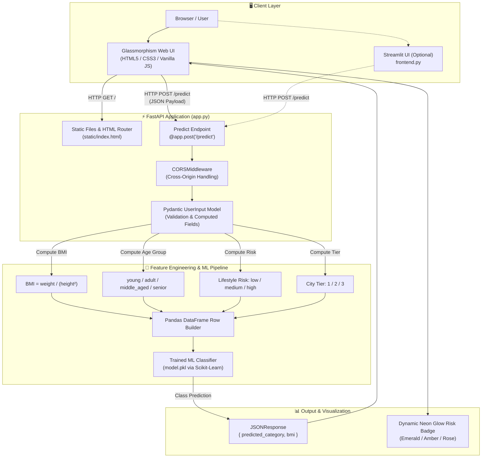
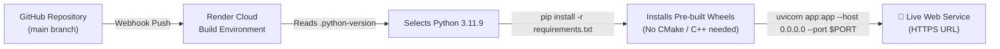

# 🛡️ AuraHealth · Insurance Premium Category Predictor

[](https://www.python.org/)
[](https://fastapi.tiangolo.com/)
[](https://scikit-learn.org/)
[](https://docs.pydantic.dev/)
[](https://render.com/)

An end-to-end Machine Learning web application that predicts health insurance premium risk categories (**Low**, **Medium**, **High**) based on client biometrics, lifestyle factors, city demographics, and income.

Built with a high-performance **FastAPI** backend, **Scikit-Learn** inference engine, and an ultra-modern, minimalist **Glassmorphism Web Interface** with live biometric calculators and morphing visuals.

---

## 🏛️ System Architecture



---

## ✨ Key Features

- **Minimalist Glassmorphism Aesthetic:** Modern frosted glass design with dynamic blur (`backdrop-filter`), subtle borders, glowing neon indicators, and ambient morphing gradient backgrounds.
- **3D Morphing Hero Card:** Visual showcasing AI health telemetry with interactive mouse-tracking 3D parallax tilt.
- **Real-Time Biometric Calculator:** As users move the sliders, the UI dynamically computes and previews **BMI**, **BMI Category chip** (Normal, Overweight, Obese), **Lifestyle Risk**, and **City Tier** without needing a page refresh.
- **Synced Range Sliders & Inputs:** Intuitive dual-input controls for Age, Weight, Height, and Annual Income.
- **Robust Schema Validation:** Powered by **Pydantic v2** with field constraints (`gt`, `lt`), computed properties, and occupation literals.
- **City Tier Resolution:** Automatically maps Indian cities into Tier 1 (Metros), Tier 2, or Tier 3 for accurate geographic risk modeling.
- **Single-Server Deployment:** FastAPI serves both the static web frontend and the REST API from a single lightweight process.

---

## 📁 Repository Structure

```text
Insurance-Premium-Predictor/
├── .gitignore               # Ignored files (pycache, envs, checkpoints)
├── .python-version          # Pinned to Python 3.11.9 for cloud build stability
├── app.py                   # Main FastAPI server, static file router & ML inference
├── fastapi_ml_model.ipynb   # Model training & exploratory data analysis notebook
├── frontend.py              # Alternative Streamlit dashboard with glassmorphism theme
├── insurance.csv            # Training & validation dataset
├── model.pkl                # Trained scikit-learn classification model pipeline
├── requirements.txt         # Optimized production runtime dependencies
├── static/
│   ├── app.js               # Client-side validation, live calculations & async fetch
│   ├── hero.jpg             # High-resolution 3D health intelligence visual asset
│   ├── index.html           # Modern glassmorphism HTML structure
│   └── style.css            # Custom CSS3 styles, glass panels & animations
└── README.md                # Project documentation & architecture
```

---

## 🔌 API Reference

### 1. Web Interface
- **Endpoint:** `GET /`
- **Description:** Returns the glassmorphism frontend application (`static/index.html`).

### 2. Interactive Documentation
- **Swagger UI:** `GET /docs`
- **ReDoc:** `GET /redoc`
- **OpenAPI Schema:** `GET /openapi.json`

### 3. Predict Premium Category
- **Endpoint:** `POST /predict`
- **Content-Type:** `application/json`

#### Request Body
```json
{
  "age": 30,
  "weight": 68.0,
  "height": 1.72,
  "income_lpa": 12.0,
  "smoker": false,
  "city": "Mumbai",
  "occupation": "private_job"
}
```

#### Field Specifications
| Parameter | Type | Validation Rules | Description |
|---|---|---|---|
| `age` | `integer` | `1 <= age < 120` | Age of client in years |
| `weight` | `float` | `weight > 0` | Body weight in kilograms |
| `height` | `float` | `0 < height < 2.5` | Body height in meters |
| `income_lpa` | `float` | `income_lpa > 0` | Annual income in ₹ Lakhs Per Annum |
| `smoker` | `boolean` | `true` or `false` | Smoking status |
| `city` | `string` | Free text | City name (e.g. Mumbai, Delhi, Jaipur) |
| `occupation` | `string` | Enum / Literal | `private_job`, `government_job`, `business_owner`, `freelancer`, `student`, `retired`, `unemployed` |

#### Successful Response (`200 OK`)
```json
{
  "predicted_category": "Low",
  "bmi": 22.985397512168742
}
```

---

## 🚀 How to Run Locally

### 1. Clone the Repository
```bash
git clone https://github.com/kumarsahup07/Insurance-Premium-Predictor.git
cd Insurance-Premium-Predictor
```

### 2. Create and Activate a Virtual Environment
```bash
# Windows (PowerShell)
python -m venv venv
.\venv\Scripts\Activate.ps1

# Linux / macOS
python3 -m venv venv
source venv/bin/activate
```

### 3. Install Dependencies
```bash
pip install -r requirements.txt
```

### 4. Start the Application
Run the FastAPI application with Uvicorn:
```bash
uvicorn app:app --reload
```

Open your browser and navigate to:
- 🌐 **Web App:** [http://127.0.0.1:8000/](http://127.0.0.1:8000/)
- 📖 **Interactive API Docs:** [http://127.0.0.1:8000/docs](http://127.0.0.1:8000/docs)

---

## ☁️ Deployment Guide (Render)

This repository includes a pinned `.python-version` (3.11.9) and minimal `requirements.txt` pre-configured for **[Render](https://render.com/)**:



### Render Deployment Steps:
1. Log in to **[Render Dashboard](https://dashboard.render.com/)**.
2. Click **New +** $\rightarrow$ **Web Service**.
3. Select your GitHub repository: `kumarsahup07/Insurance-Premium-Predictor`.
4. Fill in the service configuration:
   - **Environment:** `Python 3`
   - **Build Command:** `pip install -r requirements.txt`
   - **Start Command:** `uvicorn app:app --host 0.0.0.0 --port $PORT`
   - **Instance Type:** `Free`
5. Click **Deploy Web Service**. Your service will be live in ~20 seconds.

---

## 🛠️ Technology Stack

- **Framework:** [FastAPI](https://fastapi.tiangolo.com/)
- **Server:** [Uvicorn](https://www.uvicorn.org/) (ASGI)
- **Data Validation:** [Pydantic v2](https://docs.pydantic.dev/)
- **Machine Learning:** [Scikit-Learn](https://scikit-learn.org/), [NumPy](https://numpy.org/), [Pandas](https://pandas.pydata.org/)
- **Frontend:** Vanilla HTML5, Modern CSS3 (Glassmorphism, CSS Variables, Flexbox/Grid), Vanilla JavaScript ES6+
- **Alternative UI:** [Streamlit](https://streamlit.io/)
- **Hosting:** [Render Cloud](https://render.com/)

---

## 📄 License
This project is open-source and available under the **MIT License**.
